# The loops, stage by stage

Why loops exist is in [Why loops](../explanation/loops.md). This page is the reference: what each one takes and produces, and its stages.

skilldrop ships **loops**, not just parts. A loop is a named sequence of stages over existing skills with a gate between them: [`packs/<pack>/loops/<name>/LOOP.md`](../../packs) is what an agent reads, `loop.json` is the machine-readable contract ([RFC-0028](../../docs/rfcs/0028-loops-as-a-primitive.md)). **Nothing comes out of a loop until it passes that loop's gate.**

A loop *sequences* skills — it never contains one. Every skill stays independently installable and runnable on its own, which is what keeps a single-folder copy working in Cursor, Kiro, or Aider.

The lifecycle has five stages, separated by **reversibility**: how expensive the mistake is to unwind. Three of them have a loop. The loops for the first stage (find the problem) and the last (run it) were retired ([RFC-0074](../../docs/rfcs/0074-loops-measured-four-retired.md)), because on held-out evals their own skills, used without the loop, were preferred. Those stages use their skills in order: `feedback-synthesis`, `requirements-interview` or `user-journey-map`, then `prd-draft`; and `observability-plan`, `runbook-generator`, `incident-comms`, then `postmortem-generator`.

| Loop | Takes | Gate | Produces | Mistake costs |
|---|---|---|---|---|
| [`design`](../../packs/solution-architect/loops/design/LOOP.md) | an agreed requirement | **G1** review — `council-review`'s panel | a recorded decision (ADR) | months, unwound in code |
| [`build`](../../packs/dev-team/loops/build/LOOP.md) | an agreed requirement or triaged defect | **G2** mechanical — `pre-merge-review`'s gate script decides | merged code | a revert |
| [`release`](../../packs/dev-team/loops/release/LOOP.md) | merged code | **G3** review — `launch-readiness` on evidence; **G3.1** human go/no-go | a live, reversible rollout | users and data, often irreversible |

Plus one **wrapper**, which is not a lifecycle stage but the two passes either side of *any* generator:

| Wrapper | Takes | Gate | Produces |
|---|---|---|---|
| [`ship-a-draft`](../../packs/core/loops/ship-a-draft/LOOP.md) | raw notes, a transcript, a ticket | **G5** review — `doc-critique`'s verdict | a stakeholder-ready artifact |

And seven loops outside the delivery lifecycle, each for one job that runs alongside it:

| Loop | Takes | Gate | Produces | Mistake costs |
|---|---|---|---|---|
| [`research`](../../packs/research/loops/research/LOOP.md) | a question that turns on why something happened, and the sources | **G7** review — does diagnostic evidence separate the leading explanation? | an answer with its confidence, tied to the decision it serves | a decision made on a favourite theory |
| [`comply`](../../packs/grc/loops/comply/LOOP.md) | a change that carries risk: a launch, a vendor, new personal data | **G8** mechanical — the register's own script; **G8.1** human — the risk owner signs | a register, a DPIA and an evidence map that agree, signed by the owner | a risk accepted on a control that doesn't exist |
| [`measure`](../../packs/data-analytics/loops/measure/LOOP.md) | a dashboard request and the SQL behind its numbers | **G9** review — every query reviewed; **G9.1** human — each metric's owner confirms its definition | a dashboard spec whose numbers are defined and reviewed | a wrong number made to look settled by a chart |
| [`modernize`](../../packs/dev-team/loops/modernize/LOOP.md) | a legacy component to rewrite or move | **G10** mechanical — the new component matches recordings of the old; **G10.1** human — the cutover | a replacement that behaves the same, cut over by a person | a migration that changes behaviour nobody approved |
| [`ship-agent`](../../packs/ai-engineering/loops/ship-agent/LOOP.md) | an agent's job, tools and data | **G12** review — does every lethal-trifecta path have an architectural fix?; **G12.1** human — the owner decides the launch | a design, budget, threat model and eval plan, then a launch review of the built configuration | an agent that can be talked into sending private data out |
| [`provision`](../../packs/infra-as-code/loops/provision/LOOP.md) | an infrastructure need, then a saved plan | **G13** review — the real plan against the scope written with the module; **G13.1** human — the plan applied is the plan reviewed | a module and an apply a person approved | a destroyed database or an access rule nobody asked for |
| [`clarify`](../../packs/experience-design/loops/clarify/LOOP.md) | a confusing page and form, and the complaints | **G14** review — do the new words reach the fail points behind the complaints? | a page, strings and a blueprint that says which complaints need the service to change | better words that leave the same calls coming |

Every gate emits a verdict from one shared vocabulary ([`contracts/terminals.json`](../../contracts/terminals.json)) in five classes — pass, conditional, revise, redirect, blocked — so `READY`, `PROCEED` and `SHIP IT` are recognisably the same kind of answer. The diagrams below render on GitHub; their Mermaid sources live in [`docs/loops/`](../../docs/loops) for re-rendering.

*Diagrams below are generated from each loop's `loop.json` by [`build_loops.py`](../../build_loops.py) — edit the contract, not the picture.*

## `design` — a requirement to a recorded decision

Constraints first, then structure and diagrams, then an attack, then a panel that must agree — and only then is the decision written down as an ADR.

<!-- loop:design:start -->

```mermaid
%%{init: {'theme':'base','themeVariables':{'fontFamily':'Segoe UI, Helvetica, Arial','fontSize':'15px','lineColor':'#9AA5B1'},'flowchart':{'curve':'basis','rankSpacing':70,'nodeSpacing':50,'padding':16}}}%%
flowchart LR
    classDef gen    fill:#E8F0FE,stroke:#4C7DF0,stroke-width:1.5px,color:#1A3A8F;
    classDef review fill:#FDEAEA,stroke:#E05B5B,stroke-width:1.5px,color:#8A1F1F;
    classDef gate   fill:#FBE3A2,stroke:#D9971E,stroke-width:2px,color:#6B4500,font-weight:bold;
    classDef ship   fill:#E6F7EC,stroke:#34A853,stroke-width:2px,color:#0F6B33,font-weight:bold;

    constrain["constrain<br/><small>context-graph·nfr-spec</small>"]:::gen
    shape["shape<br/><small>design-doc·architecture-diagrams</small>"]:::gen
    threat["threat<br/><small>threat-model</small>"]:::review
    ratify["ratify<br/><small>council-review</small>"]:::gate
    record["record<br/><small>adr-generator·context-graph</small>"]:::gen
    G1{"G1 · review"}:::gate
    DONE(["complete"]):::ship

    constrain --> shape
    shape --> threat
    threat --> ratify
    ratify --> G1
    G1 == "PROCEED" ==> record
    record --> DONE

    G1 -- "REVISE (max 3)" --> shape
```

<!-- loop:design:end -->

## `build` — a requirement to merged code

A vertical slice becomes shippable code through a self-correcting loop, gated by a script whose exit code decides. The inner generate-challenge cycle is the [`feature-implement-loop`](../../packs/dev-team/skills/feature-implement-loop/SKILL.md) skill.

<!-- loop:build:start -->

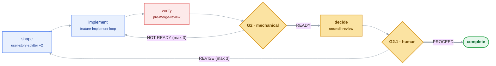

<!-- loop:build:end -->

## `release` — merged code to live users

Plan the rollout and the way back, judge readiness on evidence, draft the release notes, then a human makes the go/no-go call. The gap between a merge you can revert and a launch you often cannot.

<!-- loop:release:start -->

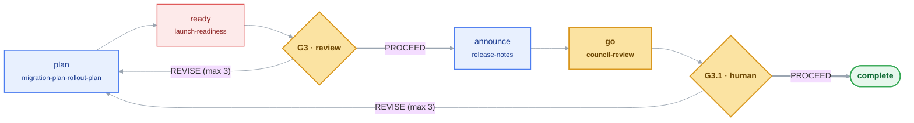

<!-- loop:release:end -->

## `ship-a-draft` — raw input to a stakeholder-ready artifact

The wrapper: structured intake before any generator, critique and a machine-residue scrub after. Loops back through intake — not the draft — until it's approved.

<!-- loop:ship-a-draft:start -->

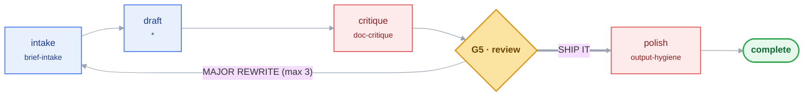

<!-- loop:ship-a-draft:end -->

## `research` — a why question to an answer the evidence carries

A plan that fixes what would change the decision before any source is read, a synthesis with every claim cited, and rival explanations ranked by how little evidence contradicts them. The gate **sends the work back** for the one observation that would tell the leaders apart.

<!-- loop:research:start -->

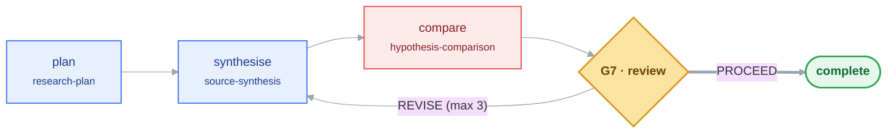

<!-- loop:research:end -->

## `comply` — a risky change to a risk position its owner signed

A risk register, a DPIA when personal data is processed, and the evidence behind every control the ratings rely on, made to agree: a control with no evidence gives no credit. The register's **own script** checks it, then the **owner** signs.

<!-- loop:comply:start -->

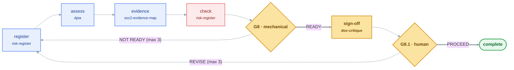

<!-- loop:comply:end -->

## `measure` — a dashboard request to numbers people can defend

The spec runs first, so only the queries behind charts that serve the decision get reviewed. A fixed query goes back through the spec, because the fix moves the number, and each metric's **owner** confirms its definition before anything is built.

<!-- loop:measure:start -->

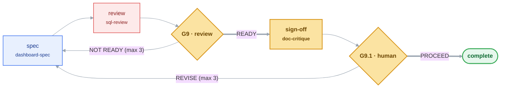

<!-- loop:measure:end -->

## `modernize` — a legacy component replaced without changing what it does

The old system's behaviour is recorded **before** anything is rebuilt, so the evidence can't be shaped by the new code. A script compares the new component against the recordings, and a **person** decides the cutover, knowing what the recordings don't cover.

<!-- loop:modernize:start -->

```mermaid
%%{init: {'theme':'base','themeVariables':{'fontFamily':'Segoe UI, Helvetica, Arial','fontSize':'15px','lineColor':'#9AA5B1'},'flowchart':{'curve':'basis','rankSpacing':70,'nodeSpacing':50,'padding':16}}}%%
flowchart LR
    classDef gen    fill:#E8F0FE,stroke:#4C7DF0,stroke-width:1.5px,color:#1A3A8F;
    classDef review fill:#FDEAEA,stroke:#E05B5B,stroke-width:1.5px,color:#8A1F1F;
    classDef gate   fill:#FBE3A2,stroke:#D9971E,stroke-width:2px,color:#6B4500,font-weight:bold;
    classDef ship   fill:#E6F7EC,stroke:#34A853,stroke-width:2px,color:#0F6B33,font-weight:bold;

    survey["survey<br/><small>codebase-tour·context-graph</small>"]:::gen
    plan["plan<br/><small>refactor-plan·migration-plan</small>"]:::gen
    capture["capture<br/><small>behaviour-equivalence</small>"]:::gen
    rebuild["rebuild<br/><small>feature-implement-loop</small>"]:::gen
    prove["prove<br/><small>behaviour-equivalence</small>"]:::review
    cutover["cutover<br/><small>launch-readiness</small>"]:::gate
    G10{"G10 · mechanical"}:::gate
    G10_1{"G10.1 · human"}:::gate
    DONE(["complete"]):::ship

    survey --> plan
    plan --> capture
    capture --> rebuild
    rebuild --> prove
    prove --> G10
    G10 == "READY" ==> cutover
    cutover --> G10_1
    G10_1 == "PROCEED" ==> DONE

    G10 -- "NOT READY (max 3)" --> rebuild
    G10_1 -- "REVISE (max 3)" --> capture
```

<!-- loop:modernize:end -->

## `ship-agent` — an agent's job to a launch its owner signed

The threat model inventories the **design's** tools, so every path from untrusted content to private data and out gets an architectural fix before anything is built. At launch, the **built** configuration is checked against what the threat model allowed, and the **owner** decides.

<!-- loop:ship-agent:start -->

```mermaid
%%{init: {'theme':'base','themeVariables':{'fontFamily':'Segoe UI, Helvetica, Arial','fontSize':'15px','lineColor':'#9AA5B1'},'flowchart':{'curve':'basis','rankSpacing':70,'nodeSpacing':50,'padding':16}}}%%
flowchart LR
    classDef gen    fill:#E8F0FE,stroke:#4C7DF0,stroke-width:1.5px,color:#1A3A8F;
    classDef review fill:#FDEAEA,stroke:#E05B5B,stroke-width:1.5px,color:#8A1F1F;
    classDef gate   fill:#FBE3A2,stroke:#D9971E,stroke-width:2px,color:#6B4500,font-weight:bold;
    classDef ship   fill:#E6F7EC,stroke:#34A853,stroke-width:2px,color:#0F6B33,font-weight:bold;

    design["design<br/><small>agent-loop-design·subagent-design</small>"]:::gen
    budget["budget<br/><small>agent-budget</small>"]:::gen
    threat["threat<br/><small>agent-threat-model</small>"]:::review
    evals["evals<br/><small>llm-eval-harness</small>"]:::gen
    launch["launch<br/><small>agent-config-review</small>"]:::gate
    G12{"G12 · review"}:::gate
    G12_1{"G12.1 · human"}:::gate
    DONE(["complete"]):::ship

    design --> budget
    budget --> threat
    threat --> G12
    G12 == "PROCEED" ==> evals
    evals --> launch
    launch --> G12_1
    G12_1 == "PROCEED" ==> DONE

    G12 -- "REVISE (max 3)" --> design
    G12_1 -- "REVISE (max 3)" --> threat
```

<!-- loop:ship-agent:end -->

## `provision` — an infrastructure need to an apply a person approved

The scope is written as resource addresses **before** any plan exists, so the review can't read the plan to fit it. Only a saved planfile is reviewed, and right before apply a **person** confirms it is the plan that was reviewed.

<!-- loop:provision:start -->

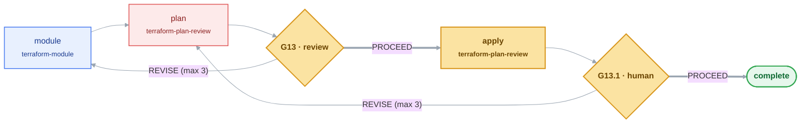

<!-- loop:provision:end -->

## `clarify` — a service people struggle with to words that reach the complaints

The complaints are written down first. After the page and the strings are rewritten, the blueprint traces every complaint to the cell that causes it, which shows the ones **new words can't stop**: those go to the service's owner.

<!-- loop:clarify:start -->

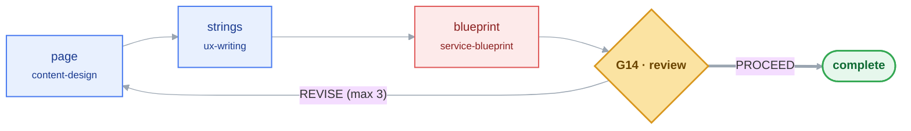

<!-- loop:clarify:end -->
