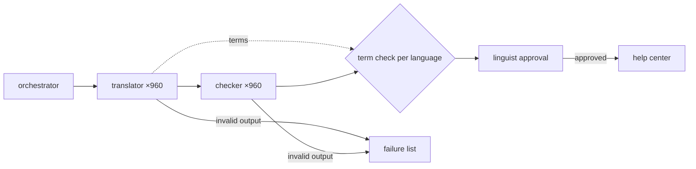

# Worked example: a seven-agent localization plan that grades its own work

Input → output oracle for `subagent-design`. Shows a fan-out that is justified but drawn
wrong: a translator that checks itself, a middle layer with no job, a summary agent standing
in for a merge, and auto-publishing. It also shows the one barrier the work actually needs.

## Input

> We're localizing our help center with AI agents. My team lead drew up the plan below. Is
> this the right setup? Our docs lead has to sign off, so keep it short.
>
> **Plan:**
> 1. A Coordinator agent spawns three Language Leads (de, fr, ja).
> 2. Each Language Lead spawns one Translator agent per article. The Translator translates
>    the article, then reviews its own translation against the glossary and fixes anything it
>    finds.
> 3. When all 960 translations are done, a Summary agent reads them all and writes a report of
>    quality issues for the docs lead.
> 4. The Coordinator publishes everything to the help center.
> 5. We want 7+ agents because more agents run faster.
>
> **Facts:**
> - 320 English articles, about 1,500 words each, into three languages.
> - A glossary of 410 product terms with an approved translation per language. Style rule: UI
>   labels stay in English.
> - Pilot of 40 articles into Japanese: the Translator's self-review marked all 40 "pass". Our
>   Japanese linguist found 11 with UI labels translated, and 4 where the same term was
>   translated two different ways in different articles.
> - Today a linguist per language approves each article before it goes live.

## Output

**Not as drawn. Splitting the work per article is right, but four parts of the plan need to
change.** Keep one translation job per article and language. A separate agent should check
each translation instead of the translator checking itself. Code should build the report, not
a summary agent. Drop the Language Lead layer. And nothing goes live without the linguist,
who stays the final approval. That leaves two agent roles, each run once per article and
language, plus code around them. The pilot is the reason: the translator passed its own work
40 times out of 40, and the linguist found problems in at least 11 of those articles.

Assumed: each article can be translated on its own, given the glossary.

# Orchestration plan: help-center localization (320 articles × de, fr, ja)

> Fan-out justification: **context separation**, because about 480,000 words of source won't
> fit one context well and each article stands alone. **Role conflict** for checking, because
> the agent that wrote a translation can't honestly grade it, as the 40/40 pilot showed.
> Speed comes with the per-article split. It is not a reason on its own.

## Role cards

### orchestrator (code, not an agent)
- **Mission:** Move each article-language pair through translation, checking and the linguist queue.
- **Inputs:** article list, glossary, UI-label rule
- **Denied (isolation):** it doesn't judge translation quality. It acts only on the fields each step returns
- **Output contract:** `{ article_id: string, lang: "de"|"fr"|"ja", status: "translated"|"checked"|"flagged"|"invalid"|"queued_for_linguist" }[]`
- **Tools/permissions:** read source articles, write to the linguist's review queue. **No publish permission**
- **On failure:** marks the item `invalid` with the reason and carries on with the rest
- **Model:** none needed: routing and merging are code

### translator ×960
- **Mission:** Translate one article into one language using the glossary.
- **Inputs:** one source article, that language's glossary, the UI-label rule
- **Denied (isolation):** other articles' translations, so each job stays small. Consistency across articles comes from the glossary and the term check below
- **Output contract:** `{ article_id: string, lang: string, body: string, terms: [{ source: string, target: string, in_glossary: bool }], status: "ok"|"blocked", blocked_reason: string|null }`
- **Tools/permissions:** none beyond its inputs. No write access anywhere
- **On failure:** `status: "blocked"` with a reason. It never sends a partial translation as `ok`
- **Model:** mid-size: translating with a fixed glossary doesn't need the largest model

### checker ×960
- **Mission:** Find every place the translation departs from the source, the glossary or the UI-label rule.
- **Inputs:** source article, translated `body`, glossary, UI-label rule
- **Denied (isolation):** the translator's `terms` list and status, so it checks the text instead of confirming the translator's claims about it
- **Output contract:** `{ article_id: string, lang: string, verdict: "pass"|"fail"|"blocked", findings: [{ type: "glossary"|"ui_label"|"meaning"|"omission", source_excerpt: string, target_excerpt: string, expected: string }] }`
- **Tools/permissions:** read-only
- **On failure:** `verdict: "blocked"`, handled exactly like `fail`. It is never counted as a pass
- **Model:** mid-size: a different agent from the translator, which is what makes the check independent

## Topology

**Shape:** a pipeline per article (translate, then check), **because** no article's
translation depends on another's. **One barrier per language**, **because** the pilot's 4
inconsistent terms only show up across articles. Code groups every translator's `terms` by
source term and flags any term with more than one translation. That check needs all of a
language's articles, and nothing else in the plan does.
**Depth:** one level. The Language Leads would only pass articles along, and the orchestrator
already does that.

## Aggregation & verification

- **Aggregation:** code. The term check groups by `(lang, source term)`. The report for the
  docs lead is counts of `findings` by type and language, plus the list of `fail` and
  `invalid` articles. Output that doesn't match its schema goes to the failure list and never
  into the report.
- **Verification:** the checker's job is to find faults, and it never sees the translator's
  own assessment. A failed article goes to the linguist with its findings attached.
- **Vote rule:** a single checker. An article is flagged if it has any finding. The linguist's
  approval gates publishing, as it does today.

## Budget line

No spending cap was given, so none is set here. Model sizes are on each card.

**Left out of the plan:** the Coordinator publishing everything. Every article still goes
through linguist approval before it goes live. The pilot shows why: the self-check missed all
11 UI-label errors.

**To confirm**
- The spending cap for a full run.
- Whether source articles mark UI labels in a way code can detect. If they do, that check
  can move from the checker to code.
- Who reworks a failed article: the linguist, or a second translation pass with the findings.

Next step: design the run around this, meaning retries, the stop conditions and what happens
when the cap is hit, before the first full batch.

## Why this is the oracle

- **The verifier is separate and adversarial, never the generator.** The plan's step 2 has
  the translator check itself, and the pilot's 40/40 self-pass is the evidence that this
  fails. The checker is denied the translator's own claims, so it can't just agree with them.
- **Aggregation is code, and a barrier needs a named dependency across items.** The summary
  agent becomes a group-by over typed `findings`. The plan's "when all 960 are done"
  synchronisation shrinks to one barrier per language, earned by cross-article term
  consistency, the 4 inconsistent terms no per-article check can see.
- **Fan out only for a named reason, keep depth to one level, and take budget numbers only
  from the user.** "More agents run faster" is rejected as a reason. The Language Lead layer
  is cut. No cap is invented, and auto-publishing is removed and named as removed.

A cheaper pass approves the seven-agent plan and tunes the prompts. It keeps self-review,
lets a summary agent paraphrase 960 translations, and leaves the Coordinator publishing. That
ships the pilot's UI-label errors across three languages straight to the live help center. The
opposite cheap answer, "use one agent", fails too: 480,000 words don't fit one context, and it
leaves the role conflict in place.
