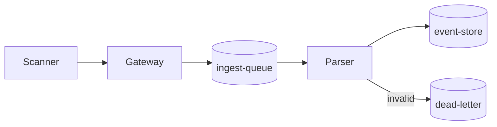

# Ingest Pipeline Design

Owner: Platform Team (Riverbend Logistics)
Status: Approved, revision 3

## Context

The ingest pipeline receives shipment events from depot scanners and writes them to the
event store. This revision moves the parser from the gateway into a dedicated worker pool
so that malformed payloads no longer stall the gateway.


## Throughput limits

| Stage          | Max events/sec | p99 latency | Scales on        |
|----------------|---------------:|------------:|------------------|
| Gateway        | 12,000         | 40 ms       | CPU              |
| Parser workers | 8,500          | 120 ms      | Queue depth      |
| Event store    | 6,000          | 250 ms      | Write IOPS       |

The event store is the bottleneck: anything above 6,000 events/sec is buffered in the queue.

## Flow



## Parser configuration

The parser rejects any payload where `weight_kg < 0` or the depot code is unknown.
Raw XML from older scanners is wrapped in CDATA before it reaches the parser:

```xml
<parser-config version="3">
  <rule id="weight" when="weight_kg &lt; 0" action="reject"/>
  <rule id="depot" when="depot not in ALLOWED" action="dlq"/>
  <legacy-wrapper><![CDATA[<scan depot="RB-07">payload]]></legacy-wrapper>
  <!-- note: a literal ]]> inside payloads must be escaped by the scanner bridge -->
</parser-config>
```

Run the replay tool against the dead-letter queue like this:

```bash
ingest-replay --queue dead-letter --since "2026-09-01" --max 500 && echo "done" > /tmp/replay.log
```

## Failover

If the parser pool loses more than half its workers, the gateway switches to
pass-through mode and events land in the queue unparsed.


> **Warning:** pass-through mode skips the weight check. Do not leave it on for more than 30 minutes.

## Open questions

- [ ] Confirm DLQ retention (currently 7 days)
- [x] Agree parser pool minimum size (4 workers)
