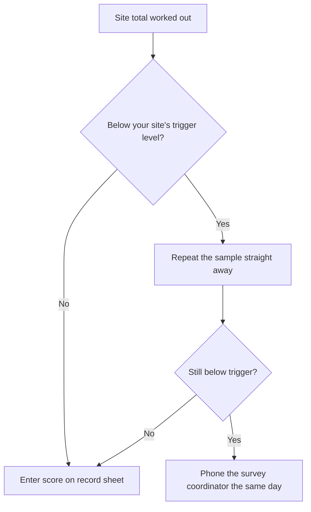

# Ellerby Rivers Trust: Kick-Sample Survey Field Guide

<iframe src="https://video.example.com/embed/kick-sampling-training" width="560" height="315"></iframe>

This guide is for trained volunteers doing the monthly invertebrate survey at their adopted site. Keep it with your kit.

## Before you go

- Check the river level gauge on the noticeboard at your site. Do not sample if the water is above the red line.
- Tell your site buddy when you are going and when you expect to be back.
- Pack: kick net, white tray, ice-cube tray, magnifier, record sheet, pencil.

## Taking the sample

1. Stand downstream of the net and hold it upright on the riverbed.
2. Kick the gravel in front of the net for **3 minutes**, moving across the riffle.
3. Do a **1-minute** hand search of stones and weed.
4. Empty the net into the white tray with a little river water.

## Counting

Sort what you find into the ice-cube tray by group and count each group.

![Stonefly nymph close-up][stonefly]

| Group | Score if 1-9 found | Score if 10-99 found | Score if 100+ found |
|---|---|---|---|
| Stonefly nymphs | 1 | 2 | 3 |
| Mayfly nymphs (flat-bodied) | 1 | 2 | 3 |
| Caddis larvae (cased) | 1 | 2 | 3 |
| Freshwater shrimp | 1 | 2 | 3 |

Add up the scores for your site total.

## What to do with your score

Return all animals to the river where you found them.

[stonefly]: img/stonefly.png
