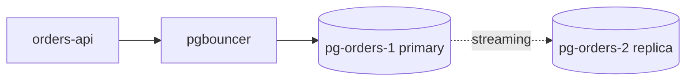

# Orders DB failover runbook

## When to use this

- The primary `pg-orders-1` is unreachable for more than 2 minutes
- Replication lag on `pg-orders-2` is under 30 seconds
- The incident commander has approved a failover

## Topology




## Procedure

1. Declare the incident in #inc-orders and page the database on-call
2. Confirm the primary is really down from two separate hosts
3. Check replication lag on `pg-orders-2` (must be under 30 s)
4. Put `orders-api` into read-only mode with the feature flag `orders.readonly=true`
5. Stop the `pgbouncer` pool so no new writes reach the old primary
6. Fence `pg-orders-1` by removing it from the load-balancer target group
7. Promote the replica:
   - Run `pg_ctl promote -D /var/lib/postgresql/14/main` on `pg-orders-2`
   - Wait for `pg_is_in_recovery()` to return `false`
8. Update the `orders-db-primary` DNS record to point at `pg-orders-2`
9. Restart `pgbouncer` with the new primary in `pgbouncer.ini`
10. Turn off read-only mode (`orders.readonly=false`)
11. Run the smoke test: place and cancel a test order
12. Watch error rate on the orders dashboard for 15 minutes
13. Post the all-clear in #inc-orders
14. Open a ticket to rebuild `pg-orders-1` as the new replica

<!-- TODO(ravi): step 9 is wrong for the v14 cluster, pgbouncer now reads the primary from DNS and must not be restarted. Confirm before the next drill. -->

## Checking replication lag

```bash
export PGPASSWORD=<set-from-vault>
psql -h pg-orders-2.db.example.internal -U ops_ro -d orders \
  -c "SELECT now() - pg_last_xact_replay_timestamp() AS lag;"
```

## Rollback

- If the promoted replica fails the smoke test, keep read-only mode on
- Escalate to the database lead; do **not** attempt to bring `pg-orders-1` back as primary
