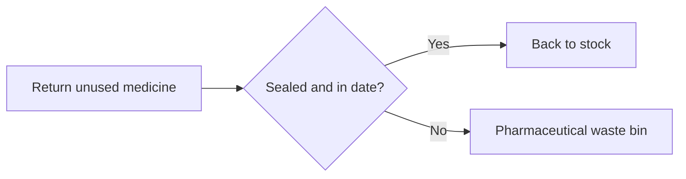

# Dispensing workflows: diagrams for the induction pack

## 1. Checking a prescription

```mermaid
flowchart TD
    A[Prescription received] --> B[Check dose (mg/kg) against chart]
    B --> C{Dose OK?}
    C -->|Yes| D[Label and dispense]
    C -->|No| E[Call prescriber]
    E --> B
    D --> end[Hand to ward runner]
```

## 2. Controlled drug request

```mermaid
sequenceDiagram
    participant N as Ward nurse
    participant P as Pharmacist
    participant S as Stock system
    N->>P: Request controlled drug
    P->>S: Check stock level
    alt In stock
        S-->>P: Quantity available
        P->>N: Two-person check and issue
    else Out of stock
        S-->>P: Zero on hand
        P->>N: Offer alternative
```

## 3. Returns


