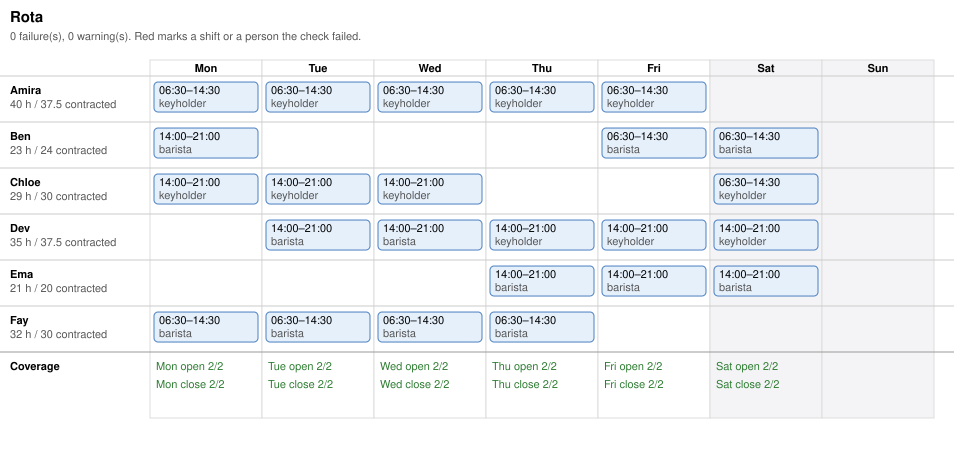

# Worked example: a café week, and the turnaround the first draft hid

Input → output oracle for `shift-roster`. It shows a first draft that looks covered and puts a
closer back on the next morning's opening shift, and the rota that passes every rule.

## Input

> Make next week's rota for the café, Monday to Saturday. Every day there's an opening shift
> 06:30–14:30 and a closing shift 14:00–21:00, and each needs one keyholder and one barista.
> Staff:
> - Amira: keyholder, barista, max 40 h, contracted 37.5
> - Ben: barista, max 24 h, contracted 24, can't do Wednesdays (college)
> - Chloe: keyholder, barista, max 32 h, contracted 30
> - Dev: keyholder, barista, max 40 h, contracted 37.5
> - Ema: barista, max 24 h, contracted 20, not Mondays or Tuesdays
> - Fay: barista, max 32 h, contracted 30
>
> At least 11 hours between shifts, nobody more than 5 days in a row.

## The first draft, and what the check found

The draft filled every shift, two people each, with the keyholders on the keyholder needs.
It put Ben on Thursday's close and Friday's open. The check failed it:

```
FAIL Ben gets 9.5 h rest between Thu close (ends Thu 21:00) and Fri open, under the 11 h minimum
FAIL Ben works 30 h in week 1, over their 24 h maximum
WARN Ema works 14 h against 20 h contracted
```

Thursday's close went to Ema instead, who is free that evening and under her hours. That
fixed all three. The reply never shows the draft: the manager sees the rota that passed.

## Output

**Rota, week of 9 November**

| | Mon | Tue | Wed | Thu | Fri | Sat |
|---|---|---|---|---|---|---|
| Amira | open 06:30–14:30 (keys) | open (keys) | open (keys) | open (keys) | open (keys) | |
| Ben | close 14:00–21:00 | | | | open | open |
| Chloe | close (keys) | close (keys) | close (keys) | | | open (keys) |
| Dev | | close | close | close (keys) | close (keys) | close (keys) |
| Ema | | | | close | close | close |
| Fay | open | open | open | open | | |

Checked: every shift has a keyholder and a barista, and nobody is under 11 hours' rest, over
their hours, on a day they can't work or more than 5 days in a row.

**Hours:** Amira 40 (contracted 37.5), Ben 23 (24), Chloe 29 (30), Dev 35 (37.5), Ema 21 (20),
Fay 32 (30). Amira is at her 40-hour maximum, 2.5 over contract, because only three people hold
keys and twelve shifts need one. A fourth keyholder would let her drop a shift.

**Rules used, as you gave them:** 11 hours between shifts, 5 days in a row. **Assumed:** at most
12 hours in a day.

The week grid is saved as `rota-week-of-2026-11-09.svg`, and the rota as `roster.json`, both in
the working folder.

## Why this is the oracle

- **The check passes before the rota is shown.** The draft was covered, and still broke rest and
  a maximum. A glance at a grid doesn't show a 21:00 close followed by a 06:30 open.
- **Skills are matched, not heads counted.** Every shift's keyholder is one of the three
  keyholders. Two baristas on an opening shift would look covered and be short.
- **The fix is the smallest change,** one shift moved to the person with room in their week,
  and the reply explains the one hours figure over contract.

A cheaper pass fills the grid evenly, says it "looks balanced", and publishes the draft:
Ben opens nine and a half hours after closing, and works six hours over his maximum.


